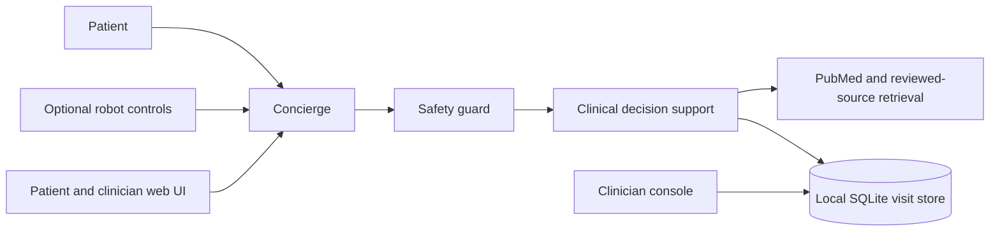

# Intelligent Medical Robot with a RAG Clinical Decision-Support System

**Design and Implementation of an Intelligent Medical Robot with a Retrieval-Augmented Clinical Decision Support System**

An Arabic-English medical-assistant robot project with a FastAPI service, a patient-facing Concierge, clinical decision-support paths, retrieval over medical references, and optional robot hardware controls.

> **Safety notice:** This is an academic and development project. It is not a medical device, does not replace a licensed clinician, and has not been clinically validated. Its outputs must not be used as a diagnosis, prescription, or emergency service. Seek qualified medical care for health concerns.

## What is included

- A bilingual patient Concierge that gathers information and coordinates with the reasoning engine.
- Clinical decision-support paths for diagnosis, treatment review, and laboratory review.
- A hybrid safety guard with deterministic red-flag checks and a bounded language-model assessment.
- Retrieval over PubMed and a structured seed knowledge base, with clinician review required for new knowledge proposals.
- FastAPI endpoints and patient and clinician web interfaces.
- Optional robot voice, camera, face-recognition, and ESP32/PCA9685 motor-control software.

The robot software is designed to execute on a Raspberry Pi 5 and can also run on a development laptop during implementation. Hardware validation is not claimed.

## Architecture



## Run the web service

Python 3.12 is recommended. From the project root:

```powershell
python -m venv .venv
.venv\Scripts\Activate.ps1
python -m pip install -r requirements.txt
Copy-Item .env.example .env
```

Edit `.env` and set the provider key you intend to use. For OpenAI, set `OPENAI_API_KEY`. To use a local Ollama server, set `LLM_PROVIDER=ollama`, configure `OLLAMA_HOST`, and provide the installed model names. Keep real keys in `.env`; never commit them.

Start the API:

```powershell
uvicorn app.api.app:app --reload
```

The API documentation is at `http://127.0.0.1:8000/docs`. The patient and clinician interfaces are served at `/ui/patient.html` and `/ui/doctor.html`.

## Optional robot setup

Install the additional robot dependencies:

```powershell
python -m pip install -r robot/requirements.txt
```

Configure the Wi-Fi placeholders in `robot/firmware_esp32/firmware_esp32.ino` locally before flashing the ESP32. Do not put real network credentials in a commit. Then run the robot controller, adjusting the camera and serial port for your hardware:

```powershell
python robot/run_robot.py --camera 0 --serial COM5
```

Robot operation requires compatible camera, audio, and ESP32/PCA9685 hardware. The code alone does not establish that a physical build has been tested or clinically validated.

## Clinical knowledge and data

The files under `data/kb100/` are development-time reference records. They require review by a licensed clinician and alignment with local guidance, medication availability, and prescribing rules before clinical use. No knowledge record authorizes autonomous prescribing. Source metadata is provided in `_source_registry.json` and the guideline catalogue.

The application creates a local SQLite database during operation. Patient records, face registries, account files, API keys, and generated logs must remain private. Do not use real patient information in a public demo or commit it to Git.

## Development

Install the development dependencies with `python -m pip install -r requirements-dev.txt`. The unit tests are in `tests/` and can be run with `python -m pytest`.

No quantitative performance results are published in this repository. Any future evaluation should be documented with its dataset, protocol, model configuration, and reproducible outputs.

## License

No reuse license has been selected for this repository yet. Public visibility does not grant permission to redistribute or reuse the source code or knowledge records.

---

## العربية

مشروع روبوت مساعد طبي ثنائي اللغة (العربية والإنجليزية)، يضم خدمة مبنية على FastAPI، وواجهة محادثة للمريض، ومسارات دعم قرار سريري، واسترجاعًا من مراجع طبية، مع دعم اختياري للتحكم في عتاد الروبوت.

> **تنبيه السلامة:** هذا مشروع أكاديمي وتطويري، وليس جهازًا طبيًا معتمدًا أو بديلًا عن الطبيب، ولم يخضع للتحقق السريري. لا تستخدم مخرجاته للتشخيص أو وصف العلاج أو التعامل مع الطوارئ. راجع مختصًا صحيًا مؤهلًا عند وجود مشكلة صحية.

### المكونات

- Concierge ثنائي اللغة لجمع المعلومات والتنسيق مع محرك الاستدلال.
- مسارات دعم القرار للتشخيص ومراجعة العلاج والتحاليل.
- طبقة سلامة تجمع قواعد حتمية لعلامات الخطر مع تقييم محدود من نموذج لغوي.
- استرجاع من PubMed وقاعدة معرفة منظمة؛ وتحتاج أي معرفة جديدة إلى مراجعة سريرية.
- واجهات API وواجهتا المريض والطبيب.
- برامج اختيارية للصوت والكاميرا والتعرف على الوجه والتحكم بمحركات ESP32/PCA9685.

برنامج الروبوت مصمم للعمل على Raspberry Pi 5، ويمكن تشغيله أيضًا على حاسوب التطوير أثناء التنفيذ. لا ندّعي إتمام التحقق من العتاد.

### التشغيل

ثبّت Python 3.12، ثم أنشئ بيئة افتراضية وثبّت المتطلبات كما في التعليمات الإنجليزية أعلاه. انسخ `.env.example` إلى `.env` وضع مفتاح مزود النموذج الذي تستخدمه. لتشغيل الخدمة:

```powershell
uvicorn app.api.app:app --reload
```

توثيق API متاح على `/docs`، وواجهة المريض على `/ui/patient.html` وواجهة الطبيب على `/ui/doctor.html`.

### المعرفة والخصوصية

ملفات `data/kb100/` مراجع تطويرية تحتاج مراجعة طبيب مرخص ومواءمة مع الإرشادات المحلية وتوفر الأدوية والقوانين قبل أي استخدام سريري. لا تسمح أي مادة بوصف دواء تلقائيًا.

ينشئ التطبيق قاعدة SQLite محلية أثناء التشغيل. احفظ سجلات المرضى وملفات الوجوه والحسابات ومفاتيح API والسجلات التشغيلية في مكان خاص، ولا تضع بيانات مرضى حقيقية في عرض عام أو في Git.

لا ينشر هذا المستودع نتائج أداء كمية. كما أن إتاحة المستودع للعامة لا تمنح ترخيصًا لإعادة استخدام الكود أو مواد المعرفة.
